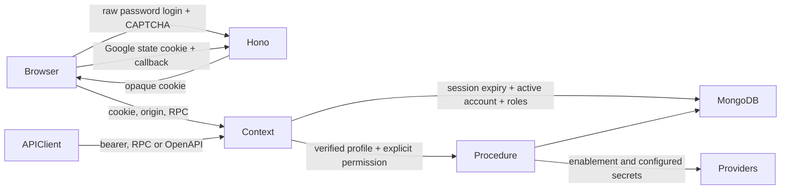

# Pre-production security audit

Current development exception: the owner requested a temporary authenticator pause for local testing. `LOCAL_DISABLE_MFA=true` is enabled only in this checkout's ignored server .env and honored exclusively in development; production startup rejects it. Original enrollment, recovery and strict-default security controls remain preserved and regression-tested. See [operations](../operations/ACCOUNT_SECURITY.md) and [current tests](TEST_RESULTS.md). This exception does not close release blockers or imply MFA is currently enforced in this local development instance.

Phase 6 continuation: [summary](PHASE6_SUMMARY.md), [committed-clone acceptance](PHASE6_FRESH_CLONE_RESULTS.md), [Git publication boundary](PHASE6_GIT_RELEASE.md). Existing security regressions passed again; developer onboarding now isolates new databases and requires explicit existing-database updates. Public publication was subsequently approved and remote-clone acceptance passed; hosted CI evidence is tracked in Phase 6. Actual second-device, provider, institutional privacy, manual accessibility and production operational gates remain open. No production-ready claim.

Phase 5: [assessment/register](PHASE5_STAGING_READINESS.md). Archived-parent evidence disclosure now has a red/green TCP regression and active-parent filter. Strict production config, explicit trusted proxies, loopback/timeouts, safe log categories and CI browser/artifact gates are locally tested. 139 Node / 34 browser / 67 HTTP / 24 grouped Forms checks pass; representative performance, exact export boundary and fresh restore evidence linked. Real infrastructure/provider/manual/privacy acceptance remains pending.

Phase 4 current evidence: [report](PHASE4_VALIDATION.md). Additive Forms receipts now provide transactional replay/rollback protection with real MongoDB/HTTP tests; default enablement remains off. Encrypted synthetic backup/restore verified all eight documents, 58 indexes and 59 required files into a clean database/directory. Production backup/key/identity/provider/CI/accessibility/privacy gates remain open; prior absent-feature statements below are historical.

Independent follow-up (2026-10-19): [local penetration validation](INDEPENDENT_PENTEST.md) reproduced and fixed PT-01, a trailing-slash bypass of the shared authentication IP limiter missed by the earlier tests. The earlier SEC-01 transport remediation was incomplete for this route spelling; its new regression and real HTTP/MongoDB acceptance now pass. Current evidence is 128 Node tests, 32 browser tests and 66 explicit TCP security checks plus a bounded 120-request database-backed burst. These supersede previous counts without resolving the outstanding production gates.

Date: 2026-10-19. Reversible baseline: clean `main` at `b04aab8dcd3926ae114a65eeacb120da98286432`. No deployment authorized. Findings refer to this baseline unless marked remediated. This is a bounded local audit, not a security certification.

**Continuation status:** the earlier uncommitted HTTP/build changes were inspected and re-tested (95 Node tests, 24 browser tests and artifact check passed). A private working-state checkpoint was saved under `.tools/security-continuation-checkpoint`. The continuation adds administrator TOTP/recovery enforcement, modern password enrollment/screening/reset, shared abuse counters, session digest migration/idle expiry/rotation, bounded lists/exports, grouped dashboard counts, request IDs, shutdown/readiness and a pinned CI draft. See [account security operation](../operations/ACCOUNT_SECURITY.md) for setup/migration details and [current results](TEST_RESULTS.md). The initial architecture/risk table below remains the historical starting evidence.

## Architecture and trust boundaries

React/TanStack Router and Query, Tailwind and shared Base UI components run in `apps/web`. Hono on Node serves raw authentication, evidence and Forms routes, oRPC at `/rpc`, and OpenAPI procedures at `/api-reference` in `apps/server/src/app.ts`. Prisma 6 uses MongoDB documents and join collections; transactions require a replica set. The native local setup binds a single unauthenticated member to loopback on 27018. It is not a production database configuration.

Authentication is custom, with Node scrypt password hashing, random 256-bit opaque database sessions, and optional Google OAuth. Browser login uses an HttpOnly, host-only, Lax cookie, Secure in production. RPC login/signup also expose bearer tokens to API consumers. No browser token storage was found in the web source. Roles union explicit permission keys; `authenticated` and `requirePermission` enforce active status and permissions server-side. Raw evidence routes share active-session/profile checks. Alumni access is global per permission, with no account-to-alumni ownership mapping or department scope.

New registrations are restricted pending email/phone verification; Google accounts also require initial password creation after recent Google verification. SMS delivery remains an intentional disconnected stub. Existing password accounts retain access. There is no MFA enrollment, recovery-code, forgot-password or reset-password flow. Email OTP is contact verification, not administrator MFA.

Environment inventory and provider setup: [deployment guide](../deployment.md). Providers include Google OAuth, reCAPTCHA, Drive, Sheets, Forms, imgBB and an HTTPS JSON mail gateway. No external provider delivery was tested in this audit. No CI workflow was found at baseline. Existing Node regression tests and synthetic Playwright/Axe fixtures cover selected security and UI workflows.

## Initial risk register

| ID       | Priority / type                     | Baseline evidence and practical impact                                                                                                                                                                                                                                  | Decision                                                                                                                                                                     |
| -------- | ----------------------------------- | ----------------------------------------------------------------------------------------------------------------------------------------------------------------------------------------------------------------------------------------------------------------------- | ---------------------------------------------------------------------------------------------------------------------------------------------------------------------------- |
| SEC-01   | P1 confirmed control bypass         | `apps/server/src/app.ts` registers the authentication limiter on `/rpc` and selected `/api` paths, but OpenAPI handles `/api-reference`. Password, signup and code requests can avoid the IP budget through that entry point. OTP still has its separate attempt limit. | Apply the same existing shared budget to every authentication transport; test aliases.                                                                                       |
| SEC-02   | P2 missing defense                  | The mutation-origin middleware rejects explicit foreign Origin/Fetch Metadata but accepts cookies with neither Origin nor Referer. Exploitation depends on browser/header behavior; this is not evidence that modern cross-site fetch bypasses the existing checks.     | Fail closed for cookie mutations without an exact trusted source origin; preserve bearer clients and OAuth GET callback.                                                     |
| SEC-03   | P2 confirmed disclosure             | `services/importer.ts` returns arbitrary caught `error.message`; Forms handler also echoes exceptions. Prisma diagnostics can expose queries, paths or connection details to import callers.                                                                            | Return safe validation/domain errors and generic operational failures; regressions with synthetic secret markers.                                                            |
| SEC-04   | P1 missing required control         | No administrator MFA in session schema, auth middleware or UI.                                                                                                                                                                                                          | Release blocker: choose maintained TOTP/passkey implementation, recovery and staged enrollment before enforcement. Do not lock out local admins through an untested rollout. |
| SEC-05   | P1 policy gap                       | New password validators allow 8 characters; `db/src/password.ts` uses default scrypt cost. No compromised-password blocklist or password recovery exists.                                                                                                               | Coordinate shared enrollment policy, client guidance, blocklist and versioned hash upgrade. Preserve existing credentials.                                                   |
| SEC-06   | P2 session hardening                | Seven-day absolute expiry; no idle policy. Tokens are stored directly in Session and returned by RPC signup/login.                                                                                                                                                      | Plan token digest migration, idle timeout, host-prefixed production cookie and explicit API-client contract.                                                                 |
| SEC-07   | P2 scalability / abuse              | Process-local IP limiter; no per-account failed-login budget. Socket peer groups clients behind a proxy.                                                                                                                                                                | Single instance only until edge/distributed and account limits are designed and tested.                                                                                      |
| SEC-08   | P1 product release blocker          | SMS stub and unconfigured mail prevent new accounts completing verification.                                                                                                                                                                                            | Keep fail-closed behavior; wire and verify providers before opening registration.                                                                                            |
| SEC-09   | P2 performance                      | Unbounded alumni/user lists and CSV exports; dashboard performs two counts per department.                                                                                                                                                                              | Add paginated contracts and measured aggregate optimization without truncating existing UI silently.                                                                         |
| SEC-10   | P2 operational gaps                 | No verified backup/restore, infrastructure TLS/storage controls, shutdown drain, full observability or CI gates. Forms has no replay ledger.                                                                                                                            | Controlled release gates; leave Forms disabled until retry/idempotency policy exists.                                                                                        |
| BUILD-01 | P2 confirmed build misconfiguration | Ordinary `pnpm build` inherits local development NODE_ENV: React development runtime and debug tooling ship in emitted assets. Explicit production mode removes these chunks.                                                                                           | Force child-only production mode for web builds; test output artifacts.                                                                                                      |

No P0 issue was established. Injection, XSS, SSRF, every resource-level authorization path, privacy requirements and supply-chain provenance have not been comprehensively proved safe. Parameterized Prisma access, upload signature/path checks, safe projections and transactional RBAC controls are present and have selected regression coverage.

## Baseline and implementation order

Baseline: 89 Node tests, 24 desktop/mobile browser tests, type checks, lint, current tracked-file secret scan and build passed. Package advisory audit returned zero known advisories (500 reported dependencies); neither scan proves absence of vulnerabilities. Existing build chunk/dynamic-import warnings and React development script-tag warnings remain.

1. Reproduce SEC-01/02/03 and apply focused, reversible fixes without schema changes.
2. Re-run Node/browser checks, types, lint, build and local performance procedure; document exact limits.
3. Complete the six readiness/report documents and correct stale deployment instructions.
4. Next group: administrator MFA and password/recovery design with local enrollment/recovery tests, then account throttling and session migration.

Reference controls: [OWASP CSRF guidance](https://cheatsheetseries.owasp.org/cheatsheets/Cross-Site_Request_Forgery_Prevention_Cheat_Sheet.html) supports source-origin verification with missing-header handling. [NIST SP 800-63B-4](https://pages.nist.gov/800-63-4/sp800-63b.html) informs the remaining password/MFA work. These are targets for verification, not a claim of conformance.

## Remediated in this pass

SEC-01, SEC-02 and SEC-03 have focused regression coverage and pass the 95-test suite. BUILD-01 is fixed and verified by the rebuilt artifact check. All 24 browser tests still pass. See [remediation log](REMEDIATION_LOG.md) for exact files/compatibility and [test results](TEST_RESULTS.md) for commands and limitations. Other register entries remain open; no production release recommendation is made.

## Continuation outcomes

| Finding | Current state                                        | Acceptance evidence and limits                                                                                                                                                                                                                                                                                                                                                                                                                                      |
| ------- | ---------------------------------------------------- | ------------------------------------------------------------------------------------------------------------------------------------------------------------------------------------------------------------------------------------------------------------------------------------------------------------------------------------------------------------------------------------------------------------------------------------------------------------------- |
| SEC-04  | Implemented and locally verified                     | Maintained `otplib` 13.5.0 (MIT), encrypted account-bound TOTP secrets, session-bound setup, password/fresh-MFA reauthentication, hashed single-use recovery, persistent step replay guards, per-account limits, backend administrative/file gate and session rotation. Node/browser and real MongoDB rollback acceptance pass. Local operator recovery core passes synthetic/real DB tests; interactive TTY and production recovery/key-rotation rehearsal remain. |
| SEC-05  | Implemented; production assurance partial            | 15–128-character enrollment policy, offline common-password dictionary, opt-in padded HIBP prefix check, versioned bounded-memory scrypt, lazy compatible hash upgrades, accessible feedback, expiring atomic reset and session revocation. Local and mocked-provider tests pass. Live delivery, mail-dependent timing and durable retries need review. No NIST compliance certification is claimed.                                                                |
| SEC-07  | Implemented; edge/capacity review partial            | Shared atomic MongoDB account counters, configurable IP budgets, MongoDB IP store by production default, alias coverage and Retry-After. Separate clients/instances share tested budgets. Fixed-window bursts, proxy address grouping, cleanup and capacity remain documented.                                                                                                                                                                                      |
| SEC-06  | Implemented; lifecycle review partial                | SHA-256 token storage with lazy legacy migration, digest-as-credential rejection, idle/absolute expiry, host-prefixed production cookie, MFA/password-change rotation and revocation. Tested in Node, browser and real MongoDB. Initial Google password creation also rotates its session and consumes its proof; full cookie-transition/TTL/soak review remains.                                                                                                   |
| SEC-08  | Mocked flows verified; external delivery pending     | Email/SMS adapter flows remain tested with synthetic providers, including successful phone completion; real SMS remains disconnected and no real messages were sent. New real registrations remain restricted until delivery is configured.                                                                                                                                                                                                                         |
| SEC-09  | Implemented bounds/query reduction; capacity partial | Stable paged arrays and both UIs, explicit 10,000-row CSV/Sheets rejection, one grouped dashboard query instead of per-department counts. Contract/query tests pass; no real traffic capacity guarantee.                                                                                                                                                                                                                                                            |
| SEC-10  | Partial                                              | Pinned read-only CI draft, safe request correlation/completion logs, writable-primary readiness, drain-before-disconnect tests and updated recovery/runbooks. Remote CI, Forms idempotency, backup restore, alerts, privacy and infrastructure acceptance remain open.                                                                                                                                                                                              |

No existing application records, private environment values, live integrations or external infrastructure were modified. Additive schema/index tests ran only in random loopback test databases; account/MFA/reset fixtures were rolled back. Database counters/indexes remain as controlled test artifacts. See the current reports for failures corrected during implementation rather than treating passing mocks as sufficient proof.
